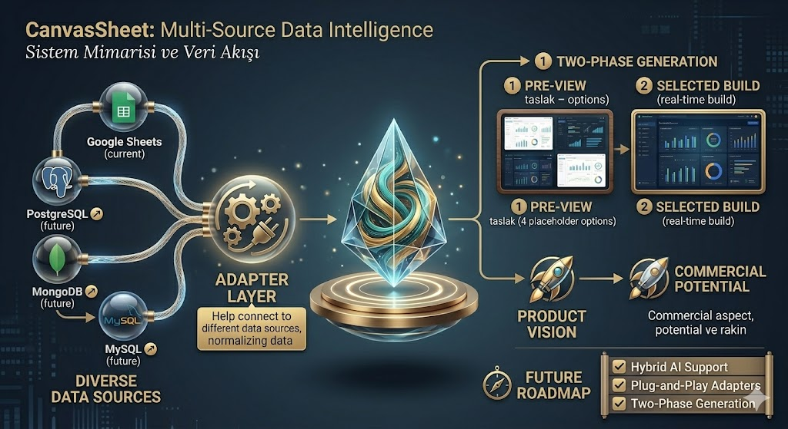

<div align="center">

# 🚀 Sheet Canvas Projesi

🏆 **Raise Summit Hackathon Başvuru Projesi!** 🏆

[](https://reactjs.org/)
[](https://vitejs.dev/)
[](https://tailwindcss.com/)
[](https://deepmind.google/technologies/gemini/)

Canvas Sheet, Google Sheets veya lokal verilerinizi saniyeler içinde büyüleyici, modern ve interaktif dashboard'lara dönüştüren, yapay zeka destekli otonom bir görselleştirme motorudur. Hiçbir backend ihtiyacı duymadan, tamamen tarayıcı üzerinden çalışan **Groq + Gemini Hibrit AI Mimarisi** ile çalışır.

<br />



<br />

**🎥 Canvas Sheet MVP Demo İzle:** [https://www.youtube.com/watch?v=XdQJRQ1bfrY](https://www.youtube.com/watch?v=XdQJRQ1bfrY)

</div>

---

## ✨ Öne Çıkan Özellikler

- 🤖 **Hibrit AI Mimarisi (Groq + Gemini)**
  Aşama 1'de Groq'un hızı ile stratejik layout (iskelet) üretilir. Aşama 2'de Gemini'nin gücüyle seçilen iskelet gerçek verilerle doldurulup parlatılır. Bu sayede token tasarrufu ve maksimum kalite elde edilir.
  
- 📊 **Otonom Veri Bağlama ve Özelleştirme**
  Sadece ne istediğinizi yazın (Örn: "Aylık net kâr gidişatını analiz et"). Yapay zeka bu analize uygun 3 farklı görsel ve metinsel vizyon (Kavram) sunar. 

- 💎 **Premium "Deep Navy" Estetik**
  Koyu tema, Glassmorphism (cam efekti), dikkat çekici neon gradyanlar ve akıcı mikro-animasyonlarla lüks bir raporlama arayüzü oluşturur. Kodlama gerektirmez, Tailwind CSS ile otonom üretilir.

- ⚡ **Sıfır Backend (Client-Side Rendering)**
  Verileriniz sunuculara gitmez; tamamen frontend tabanlı yapı sayesinde verileriniz tarayıcınızda güvende kalır. MCP (Model Context Protocol) DataHub ile yerel dosyalara da bağlanabilir.

- 🔄 **Survivor Failover Sistemi**
  Ağ veya kota sorunlarında Gemini, Groq, OpenAI ve Pollinations Architect arasında otomatik geçiş yaparak sistemin çökmesini engeller.

## 🛠️ Teknoloji Yığını

| Kategori | Teknoloji | Açıklama |
| :--- | :--- | :--- |
| **Arayüz (Core)** | React 18, Vite | Hızlı geliştirme ve modern frontend deneyimi |
| **Aşama 1 (Layout)** | Groq (LLaMA-3 70B) | Anında 3 farklı stratejik tasarım vizyonu üretir |
| **Aşama 2 (Veri)** | Google Gemini 1.5/2.0 | Seçilen vizyona gerçek verileri bağlayıp mükemmelleştirir |
| **Stil** | Tailwind CSS | Ajan tarafından anlık olarak yazılan responsive arayüzler |

## 🚀 Hızlı Başlangıç

### 1. Kurulum
Projeyi bilgisayarınıza klonlayın ve bağımlılıkları yükleyin:

```bash
git clone https://github.com/seyyah/sheet-canvas.git
cd sheet-canvas
npm install
```

### 2. Ortam Değişkenleri
Projenin kök dizininde bulunan `.env.example` dosyasının adını `.env` olarak değiştirin ve kendi API anahtarlarınızı ekleyin:

```env
VITE_GOOGLE_CLIENT_ID=Sizin_Google_Cloud_Client_ID_Anahtarınız
VITE_GEMINI_API_KEY=Sizin_Gemini_AI_Studio_Anahtarınız
VITE_GROQ_API_KEY=Sizin_Groq_API_Anahtarınız

# Opsiyonel: AI Engine Fallback Zinciri için
VITE_OPENAI_API_KEY=Sizin_OpenAI_API_Anahtarınız
```

### 3. Çalıştırma
Geliştirme sunucusunu başlatın:

```bash
npm run dev
```

## 🧠 Sistem Nasıl Çalışır? (Otonom İş Akışı)

1. **Bağlantı**: Sisteme veri kaynağınızı bağlarsınız (Google Sheets veya MCP üzerinden lokal veri).
2. **Kullanıcı İsteği (Prompt)**: Neyi analiz etmek istediğinizi kısa bir komutla belirtirsiniz.
3. **Faz 1 (Görsel Strateji)**: Groq (LLaMA) çok hızlı bir şekilde isteğinize cevap veren 3 tamamen farklı **tasarım iskeleti** üretir.
4. **Faz 2 (Veri ve Refinement)**: Siz birini seçtiğinizde, Gemini o iskeleti alır, hücreleri ve genişlikleri optimize eder ve tablonuzdaki gerçek verilerle doldurarak interaktif bir Tailwind dashboard'u olarak ekrana basar.

## 📚 Proje Dokümantasyonu

Projenin gelişim sürecini, yol haritasını ve mimarisini detaylı incelemek için aşağıdaki dosyalara göz atabilirsiniz:
- [Walkthrough (Sistem İşleyişi)](./walkthrough.md)
- [Proje Planı](./plan.md)
- [Gelecek Çalışmalar (TODO)](./future_work/todo.md)
- [Değişiklik Geçmişi (Changelog)](./changelog.md)
- [Fikir ve Teknik Belgeler](./doc/)

## 🤝 Kodlama Ajanları İçin
Yapay zeka asistanları veya otonom kodlama ajanları ile bu repoya katkıda bulunuyorsanız, projenin kuralları ve sistem mimarisi için lütfen kök dizindeki `agents.md` dosyasını okuyun.
